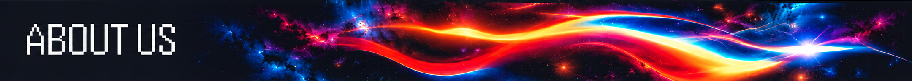
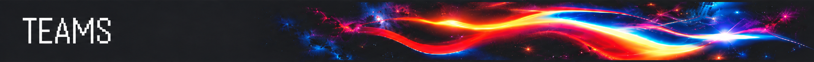
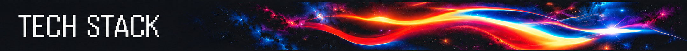
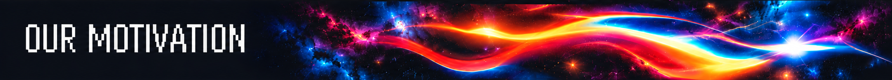

  

  

<table width="100%">
  <tr>
    <td>
      <b>Competitive Hackathon & Systems Engineering Squad</b> | Rapid Prototyping | Production Architectures  
      <b>Fantastic 4</b> is a high-performance hackathon and software engineering collective specialized in architecting resilient distributed systems, real-time web applications, and intelligent automation platforms under high-velocity constraints.  
      We unite full-stack platform engineering, distributed backend systems, applied machine learning, and automated cloud operations. From initial problem decomposition to live deployment, our squad emphasizes scalable system design, strict type safety, modular microservices, and end-to-end operational reliability.  
      Our core stack centers around <b>React, Next.js, TypeScript, Python, Django, Distributed Queues, and Cloud Infrastructure</b>. We build high-throughput REST and event-driven APIs, fluid interface systems, automated testing pipelines, and battle-tested architectures engineered to compete, win, and scale into production.
    </td>
  </tr>
</table>

  <table width="100%">
    <tr>
      <td rowspan="2" width="15%" align="center" valign="middle">
        
      </td>
      <th width="11%" align="center">GitHub</th>
      <th width="11%" align="center">Discord</th>
      <th width="11%" align="center">Core Repo</th>
      <th width="11%" align="center">Website</th>
      <th width="11%" align="center">Gmail</th>
      <th width="11%" align="center">LinkedIn</th>
      <td rowspan="2" width="15%" align="center" valign="middle">
        
      </td>
    </tr>
    <tr align="center">
      <td valign="middle">
        
      </td>
      <td valign="middle">
        
      </td>
      <td valign="middle">
        
      </td>
      <td valign="middle">
        
      </td>
      <td valign="middle">
        
      </td>
      <td valign="middle">
        
      </td>
    </tr>
  </table>

  <table width="100%">
    <tr>
      <td width="75%">
         <b>Distributed Systems & Fault-Tolerant Consensus</b> 
         
         Event-driven microservices, distributed consensus protocols, Redis-backed pub/sub queues, and partitioned database clusters engineered for low latency, zero data loss, and high concurrency.
      </td>
      <td width="25%" rowspan="4" align="center" valign="middle">
        
      </td>
    </tr>
    <tr>
      <td>
         <b>Full-Stack Real-Time Platforms & Reactive Architecture</b> 
         
         High-throughput real-time web applications with WebSocket streams, React and Next.js SSR/SSG pipelines, optimistic UI updates, and strict client-side state synchronization.
      </td>
    </tr>
    <tr>
      <td>
         <b>Applied AI, Autonomous Agents & Vector Search</b> 
         
         Multi-agent LLM systems, retrieval-augmented generation (RAG) pipelines, semantic vector search, and automated intelligence engines solving domain-specific operational bottlenecks.
      </td>
    </tr>
    <tr>
      <td>
         <b>Cloud Infrastructure, Microservice Meshes & Automated CI/CD</b> 
         
         Containerized Docker and Kubernetes topologies, infrastructure-as-code, automated GitHub Actions testing pipelines, and Prometheus/Grafana real-time system observability.
      </td>
    </tr>
  </table>

  

<table width="100%">
  <tr align="center">
    <td width="25%">
      <b>Souradeep Pradhan</b> 
      <code>Team Lead & Frontend Engineering</code>  
      
    </td>
    <td width="25%">
      <b>Aniruddha Das</b> 
      <code>Backend Engineering & Systems</code>  
      
    </td>
    <td width="25%">
      <b>Squad Member 03</b> 
      <code>Cloud Infrastructure & DevOps</code>  
      
    </td>
    <td width="25%">
      <b>Squad Member 04</b> 
      <code>Applied AI & Data Systems Specialist</code>  
      
    </td>
  </tr>
</table>

  

  <table width="100%">
    <!-- ROW 1: Core Web & Languages -->
    <tr>
      <td align="center" width="10%"> HTML</td>
      <td align="center" width="10%"> CSS</td>
      <td align="center" width="10%"> JS</td>
      <td align="center" width="10%"> React</td>
      <td align="center" width="10%"> C++</td>
      <td align="center" width="10%"> Python</td>
      <td align="center" width="10%"> MySQL</td>
      <td align="center" width="10%"> Postgres</td>
      <td align="center" width="10%"> MongoDB</td>
      <td align="center" width="10%"> Redis</td>
    </tr>
    <!-- ROW 2: Design & Data Science -->
    <tr>
      <td align="center"> Figma</td>
      <td align="center"> NumPy</td>
      <td align="center"> Pandas</td>
      <td align="center"> Matplot</td>
      <td align="center"> Seaborn</td>
      <td align="center"> Sklearn</td>
      <td align="center"> TensorFlow</td>
      <td align="center"> PyTorch</td>
      <td align="center"> LangChain</td>
      <td align="center"> LangGraph</td>
    </tr>
    <!-- ROW 3: GenAI, Backend & MLOps -->
    <tr>
      <td align="center"> HFace</td>
      <td align="center"> Ollama</td>
      <td align="center"> FastAPI</td>
      <td align="center"> Flask</td>
      <td align="center"> Streamlit</td>
      <td align="center"> Tkinter</td>
      <td align="center"> OpenCV</td>
      <td align="center"> MLflow</td>
      <td align="center"> Docker</td>
      <td align="center"> K8s</td>
    </tr>
    <!-- ROW 4: MLOps, Cloud & Tools -->
    <tr>
      <td align="center"> DVC</td>
      <td align="center"> Airflow</td>
      <td align="center"> Git</td>
      <td align="center"> AWS</td>
      <td align="center"> Azure</td>
      <td align="center"> PowerBI</td>
      <td align="center"> Postman</td>
      <td align="center"> Selenium</td>
      <td align="center"> VS Code</td>
      <td align="center"> Jupyter</td>
    </tr>
  </table>

  

<table width="100%">
  <tr>
    <td width="50%" valign="top">
      <b>Solving High-Impact Real-World Problems</b> 
      Driven by a mission to address authentic human and operational bottlenecks. We build practical, resilient software engineered to deliver immediate real-world value beyond hackathon prototypes.
    </td>
    <td width="50%" valign="top">
      <b>Unyielding Competitive Spirit & Growth</b> 
      Every competition is our crucible for refinement. Win or lose, our motto is relentless persistence—we analyze outcomes, evolve our engineering patterns, and return to the arena stronger and faster.
    </td>
  </tr>
  <tr>
    <td width="50%" valign="top">
      <b>Resilient Distributed Foundations</b> 
      We reject throwaway hacks. Every platform is architected with modular microservices, fault isolation, strict data consistency, and high-concurrency patterns engineered to scale straight into production.
    </td>
    <td width="50%" valign="top">
      <b>High-Velocity Teamwork & Relentless Craft</b> 
      Thriving under intense hackathon countdowns through deep collaboration, shared technical ownership, uncompromising code quality, and continuous curiosity across modern technologies.
    </td>
  </tr>
</table>

 

  
    
  © 2026 <b><a href="https://github.com/fantastic4-team">Fantastic 4 Team</a></b> • Engineering Resilient Systems for Competitive Innovation.

