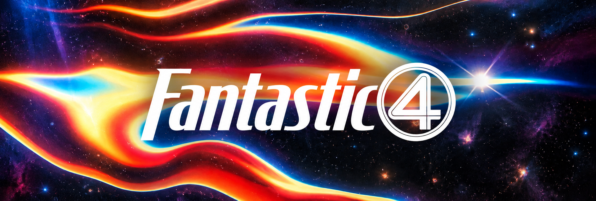

  

### About Fantastic 4

<table width="100%">
  <tr>
    <td>
      <b>Competitive Hackathon & Systems Engineering Squad</b> | Rapid Prototyping | Production Architectures  
      <b>Fantastic 4</b> is a high-performance hackathon and software engineering collective specialized in architecting resilient distributed systems, real-time web applications, and intelligent automation platforms under high-velocity constraints.  
      We unite full-stack platform engineering, distributed backend systems, applied machine learning, and automated cloud operations. From initial problem decomposition to live deployment, our squad emphasizes scalable system design, strict type safety, modular microservices, and end-to-end operational reliability.  
      Our core stack centers around <b>React, Next.js, TypeScript, Python, Django, Distributed Queues, and Cloud Infrastructure</b>. We build high-throughput REST and event-driven APIs, fluid interface systems, automated testing pipelines, and battle-tested architectures engineered to compete, win, and scale into production.
    </td>
  </tr>
</table>

   &nbsp;
   &nbsp;
   &nbsp;
   &nbsp;
  

  <table width="100%">
    <tr>
      <td width="75%">
         <b>Distributed Systems & Fault-Tolerant Architecture</b> 
         
         High-concurrency microservices, event-driven messaging pipelines, and database optimization engineered for low latency, data integrity, and high throughput.
      </td>
      <td width="25%" rowspan="4" align="center" valign="middle">
        
      </td>
    </tr>
    <tr>
      <td>
         <b>Full-Stack Real-Time Platforms & UI Systems</b> 
         
         Interactive client platforms built with React and Next.js, featuring real-time data sync, fluid UX interactions, and strict client-side state management.
      </td>
    </tr>
    <tr>
      <td>
         <b>Applied AI, Intelligent Agents & Automation</b> 
         
         LLM agent integrations, automated data processing pipelines, and intelligent decision systems solving high-complexity real-world challenges.
      </td>
    </tr>
    <tr>
      <td>
         <b>Rapid DevOps, Cloud Infrastructure & CI/CD</b> 
         
         Containerized deployments, automated GitHub Actions pipelines, cloud infrastructure provisioning, and continuous monitoring for live presentations.
      </td>
    </tr>
  </table>

### Squad Leadership & Division Roles

<table width="100%">
  <tr align="center">
    <td width="25%">
      <b>Souradeep Pradhan</b> 
      <code>Team Lead & Frontend Engineering</code>  
      
    </td>
    <td width="25%">
      <b>Aniruddha Das</b> 
      <code>Backend Engineering & Systems</code>  
      
    </td>
    <td width="25%">
      <b>Squad Member 03</b> 
      <code>Cloud Infrastructure & DevOps</code>  
      
    </td>
    <td width="25%">
      <b>Squad Member 04</b> 
      <code>Applied AI & Data Systems Specialist</code>  
      
    </td>
  </tr>
</table>

### Technology Stack & Engineering Ecosystem

   &nbsp;
   &nbsp;
   &nbsp;
   &nbsp;
   &nbsp;
   &nbsp;
   &nbsp;
  

 

### Engineering Standards & Execution Principles

<table width="100%">
  <tr>
    <td width="50%" valign="top">
      <b>Resilient Distributed Foundations</b> 
      Architected for high concurrency, fault isolation, and clean microservice separation, ensuring systems stay stable under presentation and production load.
    </td>
    <td width="50%" valign="top">
      <b>High-Velocity Prototyping</b> 
      Rapid translation of complex problem statements into functional, high-fidelity prototypes without compromising code structure or security.
    </td>
  </tr>
  <tr>
    <td width="50%" valign="top">
      <b>Automated Deployment & Testing</b> 
      Repeatable containerized configurations and continuous delivery pipelines that streamline live demos and multi-environment releases.
    </td>
    <td width="50%" valign="top">
      <b>Clean Architecture & Documentation</b> 
      Strict modular code standards, well-defined API contracts, and comprehensive technical documentation across every hackathon track repository.
    </td>
  </tr>
</table>

 

  
    
  © 2026 <b><a href="https://github.com/fantastic4-team">Fantastic 4 Team</a></b> • Engineering Resilient Systems for Competitive Innovation.

